# SecureVault LAN: Encrypted Transport & Visual Protocol Suite
## Project Report & Complete Viva Preparation Guide

**Subject:** Network Security Lab (Open Ended Lab / Final Project)  
**Platform:** 100% Native Windows 10/11 (Python 3.11, Cryptography, WebSockets, HTML5 Canvas)  
**Execution Environment:** Native Windows LAN / Wi-Fi (Zero VMs, Zero Kali Linux, Zero Simulations)

---

## 1. Executive Summary & Objectives
SecureVault LAN is a practical, production-grade secure communication and file transfer suite designed to solve the vulnerabilities of unencrypted local area networks. In typical institutional or office LAN environments, standard protocols (HTTP, FTP, Telnet) transmit data in plaintext, exposing users to Packet Sniffing, Man-In-The-Middle (MITM) attacks, and payload alteration.

### Core Objectives:
1. **Confidentiality:** Implement AES-256-GCM (Galois/Counter Mode) authenticated encryption for all payload data and streaming files.
2. **Secure Key Exchange:** Utilize RSA-2048 asymmetric encryption with OAEP-SHA256 padding for initial handshake and ephemeral session key exchange.
3. **Integrity & Authenticity:** Validate end-to-end file integrity via SHA-256 hashing and prevent bit-flipping tampering via GCM 128-bit authentication tags.
4. **Demonstrable Security:** Provide an instant UI toggle between Secure Mode and Plaintext Mode to prove cryptographic defense in real-time under Wireshark packet capture.
5. **HCI Excellence:** Provide a modern cyberpunk/liquidmorphism terminal interface featuring a 60 FPS animated data traveling pipeline, tactile feedback, and comprehensive security audit telemetry.

---

## 2. System Architecture & Cryptographic Flow

```mermaid
sequenceDiagram
    autonumber
    actor Client as Client Node (Sender)
    participant Net as Windows LAN Socket (TCP:5500)
    actor Server as Server Node (Receiver)

    Note over Server: Generates RSA-2048 Key Pair in memory
    Client->>Net: Connects TCP 3-Way Handshake (SYN, SYN-ACK, ACK)
    Net->>Server: Connection Established
    Server->>Client: Send RSA-2048 Public Key (PEM)
    Note over Client: Generates random 256-bit AES Session Key
    Note over Client: Encrypts AES key using Server Public Key (RSA-OAEP)
    Client->>Server: Transmits RSA-Encrypted Session Key
    Note over Server: Decrypts Session Key using RSA Private Key
    Server->>Client: Transmits Handshake ACK (Encrypted)
    Note over Client,Server: Shared Secret Established!

    rect rgb(0, 40, 20)
    Note over Client,Server: SECURE DATA TRANSMISSION (AES-256-GCM)
    Client->>Server: Encrypted Messages & Chunked Files + 12-byte Nonce + 16-byte Auth Tag
    Server->>Server: Authenticates GCM Tag & Decrypts Payload
    Server->>Server: Computes & Compares File SHA-256 Checksum
    end
```

---

## 3. Human-Computer Interaction (HCI) Heuristics Addressed

| Nielsen Heuristic | Implementation in SecureVault LAN |
|---|---|
| **#1: Visibility of System Status** | Live status indicator pill (IDLE / LISTENING / CONNECTED), real-time peer IP display, and 60 FPS canvas displaying traveling data packets with particle trails. |
| **#2: Match between System & Real World** | Uses clear cryptographic metaphors: Shield icons, lock/unlock badges, and an intuitive "Pipe" showing data flowing across computers. |
| **#3: User Control & Freedom** | One-click button to disconnect, abort server listening, or toggle between Plaintext and Encrypted demo modes instantly. |
| **#5: Error Prevention** | Input validation on IP address formats and numeric port ranges (1024-65535). Automated detection and alerting on tampered packets. |
| **#6: Recognition rather than Recall** | Displays session fingerprints, active cipher names, and file transfer metrics on-screen rather than requiring CLI queries. |
| **#8: Aesthetic & Minimalist Design** | Deep obsidian black palette (`#060907`) with neon cyber-green accents (`#00ff88`), liquid glass cards, and zero cluttered text. |

---

## 4. Top 15 Viva Questions & Bulletproof Answers

### Q1: Why did you use Hybrid Cryptography instead of just RSA or just AES?
**Answer:**
> *"Sir, Asymmetric cryptography like RSA is computationally expensive and slow for encrypting large files. Symmetric cryptography like AES-256 is extremely fast and efficient, but it suffers from the 'Key Distribution Problem' (how to safely send the key over an untrusted network). In Hybrid Cryptography, we get the best of both worlds: we use RSA-2048 to securely exchange a single 256-bit AES session key, and then use AES-256-GCM to encrypt all actual messages and files at high speed."*

### Q2: What is AES-GCM and why is it better than AES-CBC?
**Answer:**
> *"Sir, GCM stands for Galois/Counter Mode. Unlike CBC mode, GCM is an 'Authenticated Encryption' (AEAD) scheme. It not only provides confidentiality (encryption), but it also simultaneously computes an authentication tag (16 bytes). If an attacker alters even a single bit in the ciphertext during transit (bit-flipping attack), AES-GCM decryption throws an `InvalidTag` exception and immediately alerts us of tampering."*

### Q3: What is the purpose of the 12-byte Nonce in your protocol?
**Answer:**
> *"Sir, Nonce stands for 'Number used ONCE'. In AES-GCM, encrypting two different messages with the same key and the same nonce breaks the cryptographic security. Therefore, our engine generates a fresh, cryptographically secure 12-byte random nonce for every single packet. This also prevents Replay Attacks."*

### Q4: How do you verify file integrity?
**Answer:**
> *"Sir, before transmitting a file, the sender computes its SHA-256 cryptographic hash (checksum) and sends it in the initial metadata packet. As the receiver receives the chunks and reconstructs the file on disk, it recomputes the SHA-256 hash. If both hashes match 100%, the file is confirmed untampered and complete."*

### Q5: What is Forward Secrecy in your design?
**Answer:**
> *"Sir, the AES-256 session key is generated ephemerally in RAM for that specific session. It is never saved to a hard drive. Once the connection is closed, the key is wiped from memory. Even if an attacker records past encrypted network traffic and steals a private key in the future, they cannot decrypt the past session data."*

### Q6: How does your application prove security under Wireshark?
**Answer:**
> *"Sir, we implemented a dual-mode toggle switch. In Plaintext Mode, Wireshark's 'Follow TCP Stream' clearly displays passwords and file content in clear ASCII. But when we toggle to Secure Mode, the exact same data displays as indecipherable binary ciphertext with GCM tags, proving confidentiality."*

### Q7: Why did you not use standard Cisco Packet Tracer simulation?
**Answer:**
> *"Sir, Packet Tracer is a simulated sandbox that runs simulated canned traffic. Our project is a 100% real, operational software running on real Windows TCP/IP sockets. It sends real packets over our physical Wi-Fi network card and can be inspected live on Wireshark, providing real-world practical security implementation."*

### Q8: What padding scheme is used with RSA?
**Answer:**
> *"Sir, we use OAEP (Optimal Asymmetric Encryption Padding) with SHA-256. Older PKCS#1 v1.5 padding is vulnerable to Bleichenbacher padding oracle attacks. OAEP adds randomized probabilistic padding, making the encryption semantically secure against chosen-ciphertext attacks (IND-CCA2)."*

### Q9: What happens if an attacker on the LAN attempts Man-In-The-Middle (MITM)?
**Answer:**
> *"If an attacker tries to intercept and modify the encrypted packets, AES-GCM tag verification fails immediately and triggers our visual Red Alert. If they try to impersonate the server, they cannot decrypt the client's session key because only the legitimate server holds the corresponding RSA private key."*

### Q10: How does your binary framing protocol prevent TCP stream issues?
**Answer:**
> *"Sir, TCP is a stream-based protocol without message boundaries (packet coalescing and fragmentation can occur). Our custom protocol uses a 9-byte header containing Magic Bytes (`SV`), Mode, Frame Type, Nonce Length, and Payload Length. This ensures our socket receiver knows exactly how many bytes to read before reconstructing the frame."*

---

## 5. Automated Test Verification Results

All tests have been verified headlessly using the Python unittest runner:
- `test_rsa_handshake_and_key_exchange`: **PASSED** (RSA-2048 keypair generation & OAEP decryption)
- `test_aes_gcm_encrypt_decrypt`: **PASSED** (256-bit GCM cipher and decipher)
- `test_tamper_detection_integrity`: **PASSED** (1-bit flipped ciphertext throws `InvalidTag`)
- `test_sha256_file_integrity`: **PASSED** (Disk file streaming checksum verification)
- `test_protocol_frame_pack_unpack`: **PASSED** (Binary socket stream parsing)
- `test_full_e2e_secure_handshake_and_transfer`: **PASSED** (Full client-server socket lifecycle on localhost)
