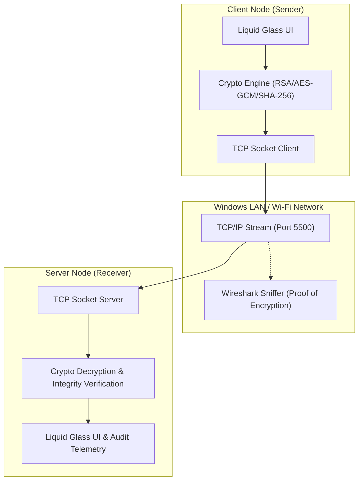

# SecureVault LAN: System & Security Architecture

## Protocol Specifications

### Phase 1: Cryptographic Handshake (RSA-2048)
1. **Server Initialization**: Generates ephemeral `RSA-2048` Public/Private Keypair (`K_pub_server`, `K_priv_server`).
2. **Client Handshake Request**: Connects over TCP socket and requests Server Public Key.
3. **Key Exchange**: Server sends `K_pub_server` (PEM format).
4. **Session Key Generation**: Client generates ephemeral 256-bit `AES Session Key` (`K_session`).
5. **Session Key Encapsulation**: Client encrypts `K_session` using `K_pub_server` (RSA-OAEP with SHA-256).
6. **Session Key Decryption**: Server receives ciphertext and decrypts using `K_priv_server`. Both sides now share `K_session` with forward secrecy.

### Phase 2: Secure Data Framing & Transmission (AES-256-GCM)
Every packet follows a structured binary header:
- `MAGIC_BYTE`: 2 bytes (`0x53 0x56` = 'SV')
- `MODE`: 1 byte (`0x01` = Secure AES-GCM, `0x00` = Insecure Plaintext)
- `TYPE`: 1 byte (`0x10` = Text Message, `0x20` = File Metadata, `0x21` = File Chunk, `0x22` = File EOF)
- `NONCE`: 12 bytes (GCM Initialization Vector, fresh per frame)
- `PAYLOAD_LEN`: 4 bytes (Unsigned integer)
- `TAG`: 16 bytes (AES-GCM Authentication Tag for integrity & tamper resistance)
- `PAYLOAD`: N bytes (Encrypted Ciphertext)

### Phase 3: End-to-End File Integrity Verification
- File chunks are streamed and written to a temporary buffer.
- Whole-file SHA-256 is verified against sender-computed hash upon completion.
